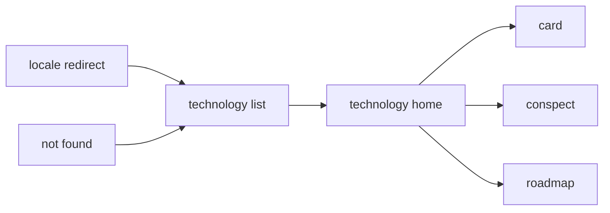

# Navigation Map

No authentication. Locales are `ru` and `en`.

## Guards and redirects

| Route | Guard | Where it sends on denial |
|-------|-------|--------------------------|
| `/` | none | `/ru/` |
| `/{unknown}/...` | prefix is not `ru` or `en` | same path under `/ru` |
| `/{locale}/{tech}` | `tech` must be in `src/data/technologies.ts` | 404 |
| `/{locale}/javascript/conspect` and `.../roadmap` | javascript has only `cards` | 404 |

## Transition edges

- `SCREEN-locale-redirect` → `SCREEN-technology-list` (`/ru/`) : opening `/` or an unknown locale.
- `SCREEN-technology-list` → `SCREEN-technology-home` : technology link.
- `SCREEN-technology-home` → `SCREEN-card` : card link, when `cards` is a kind.
- `SCREEN-technology-home` → `SCREEN-conspect` : section link, Vue only.
- `SCREEN-technology-home` → `SCREEN-roadmap` : study-plan link, Vue only.
- `SCREEN-app-frame` locale switch : same path with `/ru` or `/en`.
- `SCREEN-roadmap` tab `day1` → panels `day2`, `day3`, `optional`, `glossary` : `data-tab`. Default `day1` unless `localStorage` `vue-roadmap-tab-v1` says otherwise.
- Glossary panel → `terms` or `lifecycle` : `data-gloss`. `terms` is shown first. The subtab is not stored.
- `SCREEN-not-found` → `SCREEN-technology-list` : home link.

## Graph

